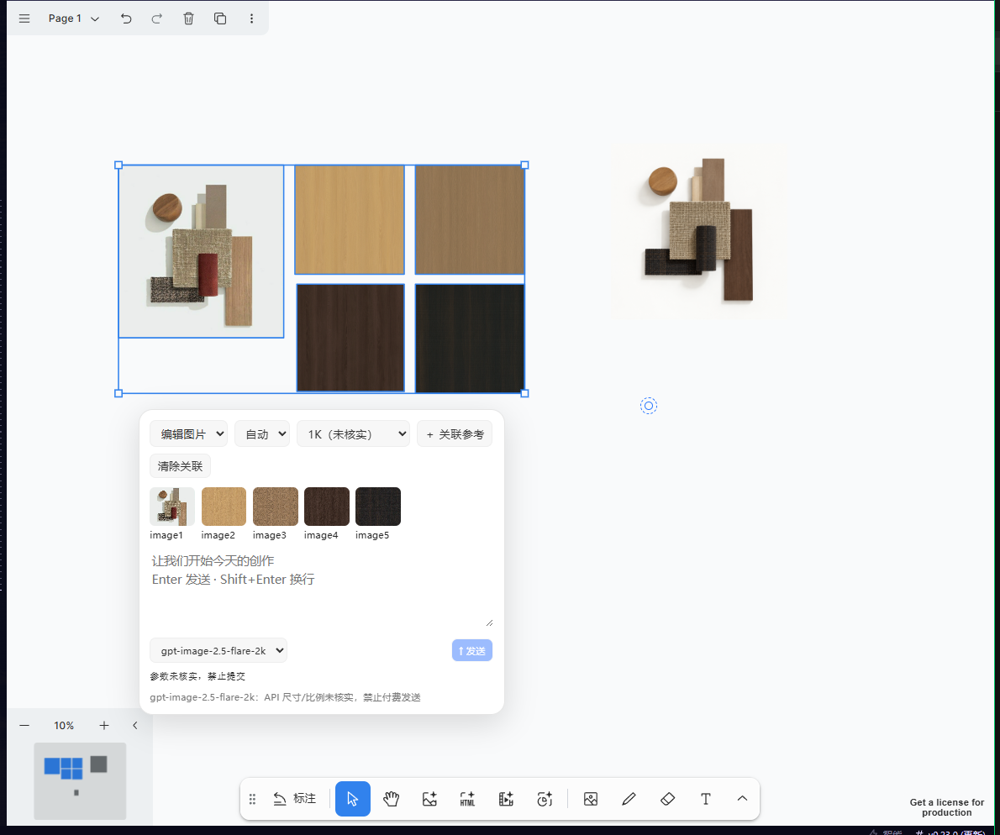

# Cowart-Hermes

把 Cowart 画布接入 Hermes Desktop 与当前会话图像工具的 Windows 适配器。包含可维护的适配源码、预构建 Cowart MCP/widget、离线测试、确定性打包工具。

> **发布状态：adapter-only，核心兼容及适配代码许可待确认。** 普通新装 Hermes 不保证可用，安装器会拒绝不兼容核心。本仓不包含 Hermes 核心补丁，也不是一键升级整个 Hermes 的安装器。发布到公网前须完成 [发布门禁](docs/PUBLISHING.md)。

## 功能
- Desktop 双面板与选区驱动创建卡；空白取消选择/Escape 隐藏，不丢失草稿；仅抑制上游图片生成表单。
- 显式 alias/model/size 与有序参考图；文本模式不附带参考图。
- 冻结任务、requestHash、session、原子 claim → complete/fail；重复回调幂等，不自动重试收费请求。自动闭环依赖兼容 Hermes 核心。
- 用户主动请求与代理自行发起请求区分；unknown 是未知证据，不等于验证通过。
- 本地输入/输出统一命名、签名识别扩展名、SHA256 校验与受限资产映射；不移动历史图片。

## 快速开始
1. Windows 10/11、Node.js ≥22、可用 Hermes Desktop，以及通过 `core-preflight.py` 的兼容 Hermes Python 环境。
2. 阅读 [中文安装指南](INSTALL.zh-CN.md)、[核心要求](core-integration/README.md) 和 [许可边界](LICENSE)。不运行 npm install，不安装上游/tldraw 依赖。
3. 将发布 ZIP 完整解压到固定可写目录；运行 `install.cmd`，通过后运行 `start.cmd`。
4. Hermes Desktop 执行 Reload desktop plugins；已有会话 `/reload-mcp`。核心更新则需要从会话外完整重启 gateway。
5. 打开 Cowart，选择图片或 AI holder，设置模式/模型/尺寸，提交到当前 Hermes 会话；观察任务成功或失败，不要通过重复点击进行付费诊断。

配置图像供应商及凭证是目标用户责任，包中没有密钥。离线安装不代表离线生图。

## 源码开发与离线验证
```sh
python scripts/validate.py
python build-portable.py
python audit-portable.py
```
不下载依赖、不调用供应商、不注册 MCP、不修改活动 Hermes 配置。验证创建隔离 HOME/HERMES_HOME 和临时目录；完整结果在被 Git 忽略的 `release-assets/`。

## 目录
```text
*.mjs / widget-bridge.js / plugin.template.js  适配源码
portable.mjs / install.cmd                    目标机安装与生命周期
core-preflight.py / core-integration/         核心兼容检测和接口说明
model-capabilities.json                      匿名历史能力观察
vendor/cowart/                               原始预构建上游及源码/许可
THIRD-PARTY-LICENSES/                         锁定依赖许可副本
scripts/ tests/                              本地零付费测试
build-portable.py / audit-portable.py         离线确定性构建与审计
docs/                                        架构、配置、发布与维护
release-assets/                              ZIP、校验和、验证报告（不提交）
```
||
|-|
||


# Cowart-Hermes Windows 中文安装与维护指南 1.0.15

> 本次源码发行是 adapter-only；不是通用 Hermes 一键整合包。发布前还须确认适配代码许可（见 LICENSE）。以下说明中的历史 UI/安装验收来自维护环境，不是本次整理重跑结果；本次实际测试范围以 release-assets/VALIDATION.json 为准。核心兼容要求见 core-integration/README.md，普通新装 Hermes 可能被 preflight 拒绝。

## 图片存储（1.0.15）

首次安装可通过 `COWART_IMAGE_INPUT` 与 `COWART_IMAGE_OUTPUT` 配置输入/输出目录，写入目标 config.json 的 imageInputDir/imageOutputDir。新输入命名 `cowart inputyyyy-MM-dd01.png`，生成输出命名 `Hermes cowartyyyy-MM-dd01.png`；日期取系统本地日期，两套每日序号独立，超过99自然扩展，扩展名按实际文件签名确定。新安装未配置时默认 canvasDir/images 与其 input 子目录，可配置为该机器可写目录，不强制 E 盘。

存储使用独占创建、每日已有文件扫描、持久身份索引及写后 SHA256 校验。相同输入内容复用、输出按 job 身份幂等；回调先落盘再使用 outputPath 插入。新 data URL 快照导入及 save_reference 经桥接拦截，兼容 /page-assets URL 由受限持久映射解析；不开放任意路径读取。旧图片不移动、不删除。上游插入可能留下兼容副本，但画布资产映射使用新输出路径。目录失败明确报错、不回退；崩溃遗留 .cowart-index/*.lock 须人工确认无写入后移除（不自动破锁）。仅 Cowart 生效，不改变普通聊天输出。

离线验证：`node --test tests/*.test.mjs`；真实上游 MCP 隔离验证：`node tests/storage-real-mcp.mjs`。均不调用图像供应商。升级需重启独立 bridge，并重新加载 MCP 代理。HTTP widget 与 stdio MCP 共用受限映射，导出按映射回读；剪贴板支持 dryRun 验证不修改系统剪贴板。真实 Chrome 媒体上传、drop/paste 事件导入及重载解码已在隔离画布验证；drop/paste 未操纵系统剪贴板或操作系统拖拽。


## 前置条件与授权
- Windows 10/11，已安装可正常使用的 Hermes Agent **及 Hermes Desktop**、Node.js 22 或更高（`node --version`）。此包不包含 Hermes/Node 安装器；准备好这些前置组件后，安装无需联网、无需 Codex、无需 npm install 或预装 tldraw。
- 本包包含 Cowart 0.1.38 的完整预构建 MCP/widget、内嵌字体及相关运行资源；没有复制原电脑的画布、凭证或插件 token。
- 阅读 `vendor/cowart/LICENSE`、`THIRD-PARTY-NOTICES.md` 和 `THIRD-PARTY-LICENSES/`。Cowart 的 MIT **不等于 tldraw 商业授权**；自行确认 tldraw 的使用/生产部署许可。本包不提供商业授权或许可密钥。

## 安装
1. 解压整个 ZIP 到当前用户可写、路径固定的文件夹，例如用户 Documents 下的 Cowart-Hermes-1.0.15。不要直接在 ZIP 内运行，不要放 Program Files，不需要管理员权限。
2. 双击 `install.cmd`。默认通过 Hermes Python 的路径 API 发现当前/默认 Hermes home，使用官方 `hermes mcp add` 注册 `cowart`。在目标电脑生成随机 bridge token 和 Desktop 插件，绝不继承原电脑密钥。
3. 双击 `start.cmd`，见到 `Started; health verified.` 后在 Hermes Desktop 命令面板执行 **Reload desktop plugins**，打开 Cowart 面板。已有会话执行 `/reload-mcp`，或开启新会话。
4. 双击 `stop.cmd` 只关闭本包身份匹配的桥服务；不会 kill 所有 node，不会关闭 Hermes。启动不自动加入开机启动。

Hermes 路径不能自动发现时，在 cmd 中运行（请填写目标机实际路径）：
```
set COWART_PYTHON=D:\your-hermes\venv\Scripts\python.exe
set HERMES_HOME=D:\your-hermes-home
node portable.mjs install
```
`HERMES_HOME` 显式指定时优先，适合独立 profile。只将包安装到你明确选择的 profile。Desktop 的插件加载与 profile 切换可能依赖 Hermes 版本；本包没有验证多 profile 同时显示。

默认端口 43189，若占用会**拒绝安装/启动**，不终止其他程序。在首次安装前可设置 `COWART_PORT=其他空闲端口`。默认数据目录为目标 Hermes home 下的 `cowart-data/canvas`；最终图片默认为 canvas/images，输入为其 input 子目录；生成任务记录仍为 `cowart-data/generated`。首次安装可用 `COWART_CANVAS` 指定其他可写画布目录。安装完成后不要移动包目录；若移动请卸载后重新安装。

## taskId 与自动回填契约
每条 Cowart 请求包含 `COWART_TASK_ID=<id>` 头和最小 JSON；ID 不传给供应商。核心必须具备 `tools/image_generation_cowart.py` lifecycle v1 与 handler wrapper。安装 preflight 实际执行随包 `tests/task-lifecycle-test.py`（离线 mock，禁止供应商网络）。不兼容主机拒绝安装，本 ZIP 不分发或注入核心补丁。

首次执行以 sessionId + requestHash 原子 claim，重复/已结束任务不再调用供应商。成功后 Pillow 实测尺寸并回调，provider/文件/尺寸错误走 fail；回调读回状态。桥断线、进程被强制终止不保证即时回填；错误明确返回 callback_failed，重启桥将未结束任务标失败，不自动重生成。不能认证的缺 ID/跨 session/hash 变更请求只拒绝，不擅自改写其他任务。普通聊天图像请求不需要 taskId。手工恢复脚本 complete-job.mjs 必须显式传匹配的 session-id。

## 核心更新后的必要重启
磁盘 preflight 通过不代表活动 gateway 已加载补丁。更新核心后必须从会话外部完整停止并重新启动 Hermes gateway，再重新打开 Desktop/会话；仅 Reload desktop plugins、/reload-mcp 或重开窗口不会替换 gateway 内存中的 Python 模块。不要从正在运行的会话工具内 kill gateway。
重新加载后的 image_generate size 描述应包含 `host-confirmed user request` 和 `unknown`；仍见旧描述或 `unverified_route` 时，先排查旧进程/错误运行目录，不要付费试图验证。

## 生图配置与已知限制
- 目标用户须自行在 Hermes 配置图像服务；不转移 `.env`、API key，不改聊天/生图默认端点。生产请求只交给当前 Hermes 会话，不使用独立 worker。
- **本包不是完整 Hermes 核心升级包。** 安装前运行 `core-preflight.py`，缺少 schema 6 operation-aware validator、handler 或 provider 即清楚拒绝。请先准备兼容核心；本包不会自动安装核心补丁，也不保证任意官方版本可用。
- 通过前置检查后安装器受控同步能力表并生成目标机绑定。可手动执行 `node sync-capabilities.mjs --target <目标 Hermes 源码目录>`，然后加 `--check` 复核。包目录移动、升级或回滚后需要重新同步，详见 `CAPABILITY-SYNC.md`。
- 用户主动提交允许 unknown 能力实际调用一次；unknown 不改写为 verified。Cowart 将 userInitiated=true / approvalMode=user_confirmed 写入经 token 验证的本地冻结任务；核心按当前 session、user turn 和完整参数匹配，不信任工具参数或普通提示词中的 approval 字段。非用户来源的 unknown 返回 approval_required；保留尺寸、路径、端点和失败校验，502/尺寸不匹配不自动重试。
- 最低安全边界为本机当前用户：Host/Origin/token + 会话/冻结参数匹配，不是抵御已获本机文件/terminal 权限的恶意 agent 的密码学隔离。直接聊天目前只保守识别明确中英文图像祈使句；复杂同义表达可能仍要求审批。无原始当前 turn、cron、委派默认不授予批准。
- 核心还需 tools/image_generation_approval.py、agent/turn_context.py、agent/tool_executor.py、agent/agent_runtime_helpers.py、model_tools.py 的来源传递及 handler/provider approval 参数补丁。包只含适配器，不自动转移核心补丁；preflight 拒绝旧核心。核心重载仍需另行验证，离线 preflight 不证明活跃 gateway 已更新。
- 安装离线 ≠ 生图离线。AI、外部网页/媒体、上游统计等联网功能需要网络；没有付费真实全链路生图验收。creation-service 单测使用模拟 Hermes 回调，不能当作供应商生成成功证据；生产路由由当前 Hermes 会话调用图像工具，再通过本地回调回填。
- 未承诺 macOS/Linux、自动编辑保存、视频/HTML 导出/剪贴板等全功能端到端验证。此交付验证桥端口、安全检查、真实空画布 MCP 读取、widget 与脚本资源及安装/停止流程；不等于在另一台物理电脑测试。

## 卸载、升级与回滚
- 双击 `uninstall.cmd`：经实例/token/注册路径匹配后停止本包服务，用官方 Hermes CLI 删除 cowart MCP，删除本包 Desktop 插件；**保留所有画布、图片和生成记录**。保留安装目录便于排查；不自动删用户数据。
- 升级前停止服务，备份 `cowart-data`（或自选画布目录），卸载旧版，解压新版到新目录安装，指向同一 `COWART_CANVAS`；新安装生成新 token。旧版目录不要覆盖。
- 回滚：卸载新版，保留/备份当前数据，在旧版的干净 ZIP 解压目录重新安装，指定之前的数据目录。必要时恢复升级前的数据备份。不要直接复制旧 token 或旧 plugin.js。
- 桥 API `/v1/tool` 与 postMessage `cowart-hermes/v1` 保持 v1，创建 API `/v2/jobs`、`/v2/state`、`/v2/anchor` 为 v2。未来不兼容数据迁移必须另行备份，不自动假定降级兼容。
- 安装失败若已生成 `config.json` 或已注册 cowart，先查日志/`hermes mcp list`，使用 `hermes mcp remove cowart` 清理本次失败注册，再重新解压干净包安装；不要覆盖其他已有插件。不要手改 Hermes config.yaml。

## 验证与隐私
`MANIFEST.sha256.json` 列出包内文件 SHA256；随包完整保留第三方许可。安装后 token/plugin/config/log 是**目标机私有数据**，不要将安装目录重新压缩分享。

源码验证：`node --test tests/*.test.mjs`（包内为无付费请求的单元测试）。维护者的发布验证结果另附 ZIP 外的验证报告。桥监听 127.0.0.1，校验 Host、Origin、token、MCP 工具白名单；不要将其转发到公网。


## 升级、卸载与限制
先停止服务并备份数据，卸载旧注册，再在新目录安装；不覆盖旧目录，不复制 token/plugin.js。卸载保留画布与图片，详见安装指南。未提供隐私画布截图，也不把示意图冒充运行截图。macOS/Linux、另一台物理机、付费生成全链路没有在本次发布整理中验证。上游统计与外部嵌入可能联网。

[架构](docs/ARCHITECTURE.md) · [配置](docs/CONFIGURATION.md) · [贡献](CONTRIBUTING.md) · [安全](SECURITY.md) · [发布](docs/PUBLISHING.md)
